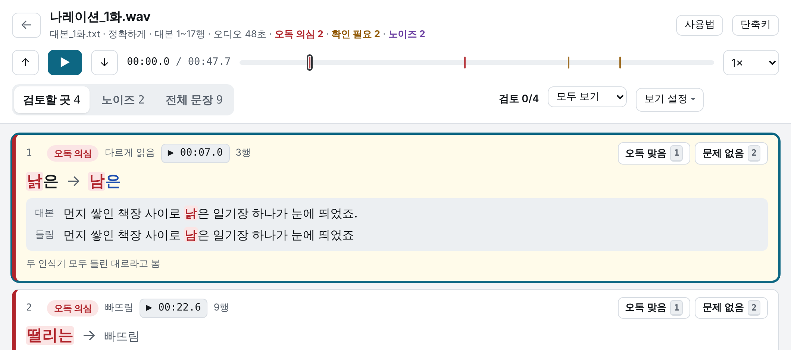

#  나레이션 오독 체크 (데모 버전)

녹음한 나레이션을 대본과 비교해 **잘못 읽은 곳, 빠뜨린 말, 덧붙인 말**과 **노이즈**(팝·찌그러짐·끊김)를 찾아 주는 무료 프로그램입니다.

### ⬇️ [최신 버전 받기](https://github.com/richer1play/narration-check/releases/latest)

받는 방법, 시작하는 방법, 할 수 있는 것, 문의처는 모두 위 링크에 있습니다.

## 이 저장소에 있는 것 (개발용)

배포 파일을 실제 Windows와 Mac(GitHub Actions)에서 사용자처럼 풀고 실행해 보는 시험 설정만 있습니다.

- `.github/workflows/test-release.yml`: 릴리스의 zip을 받아 압축 풀기 → 시작 파일로 실행 → 실제 검사 → 검수 화면 확인.
  새 버전이 **pre-release**(시험판)로 올라오면 자동으로 시험하고, Windows와 Mac 모두 통과하면 정식 최신 버전으로 바꾼 뒤
  `PACKAGE.md`를 그 버전의 zip에 맞게 새로 만듭니다.
- `PACKAGE.md`, `docs/package/`: 최신 버전 zip에 든 고지·라이선스·사용법 파일 원문 (`ci/make_package_doc.py`로 자동으로 만듦)
- `ci/`: 시험용 녹음과 대본, 시험 스크립트. 시험용 녹음은 지어낸 문장을 합성 음성(espeak-ng)으로 읽은 것이며 실수 두 곳이 들어 있습니다.
